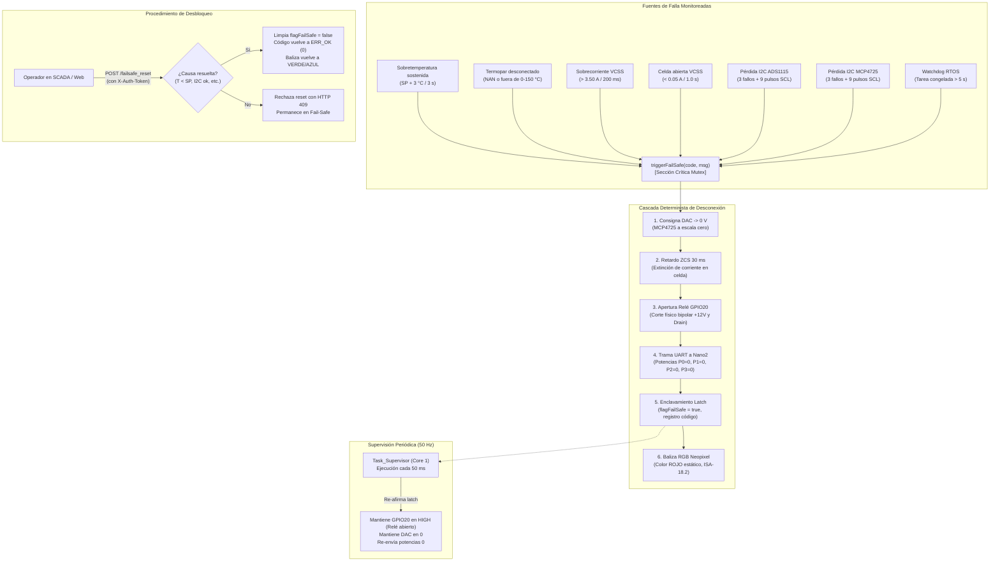

# Matriz Integral de Interlocks y Seguridad Funcional (Fail-Safe)

🌐 **Documento de Referencia Técnica y Operativa** · Planta Modular de Electrodeposición Ciberfísica
Base de Diseño: Auditoría Técnica Integral (§B.7) · Repositorio: `c:\Proyecto\Proyecto`
Versión: **2.0 (Post-Remediación Lotes A-D)** · Última actualización: Octubre 2026

---

## 1. Tabla Maestra de Interlocks y Mecanismos de Seguridad

Esta tabla consolida **todos los interlocks y barreras de seguridad funcional** implementados en el firmware (ESP32-S3 RTOS 2.0 y Arduino Nano2), detallando la condición de disparo, la acción determinista ejecutada, el código de error resultante, el mecanismo de rearme y la ubicación exacta en el código fuente.

| ID | Nombre del Interlock / Falla | Condición de Disparo | Acción Determinista del Firmware | Código de Error | Tipo de Rearme | Archivo y Referencia en Código |
| :-: | :--- | :--- | :--- | :-: | :-: | :--- |
| **INT-01** | **Sobretemperatura Sostenida** | Temperatura medida en cualquier tina activa supera la consigna en $\ge 3.0\ ^\circ\text{C}$ durante $> 3.0\text{ s}$ consecutivos ($T_i > SP_i + 3.0\ ^\circ\text{C}$). | Ejecuta `triggerFailSafe`: corta inmediatamente potencias de los 4 canales térmicos a 0%, rampa DAC a 0, abre relé VCSS GPIO20 y bloquea la planta. | `ERR_TEMP_OVERHEAT`<br>(Código `14`) | **Latch Manual**<br>(Requiere POST `/failsafe_reset` con token tras enfriamiento) | [`Modulo_Termico.cpp`](file:///c:/Proyecto/Proyecto/firmware/esp32/RTOS2.0/Modulo_Termico.cpp)<br>Constantes en [`config.h`](file:///c:/Proyecto/Proyecto/firmware/esp32/RTOS2.0/config.h) |
| **INT-02** | **Termopar Abierto o Desconectado** | Lectura del digitalizador MAX6675 devuelve `NAN` o temperatura fuera del rango admisible ($T < 0.0\ ^\circ\text{C}$ o $T > 150.0\ ^\circ\text{C}$) con el canal térmico encendido. | Ejecuta `triggerFailSafe`: apaga todas las salidas de calentadores a 0%, abre relé VCSS y fija baliza Neopixel en ROJO estático. | `ERR_TERMOPAR_DESCONECTADO`<br>(Código `11`) | **Latch Manual**<br>(Requiere POST `/failsafe_reset` tras reconectar termopar físico) | [`Modulo_Termico.cpp`](file:///c:/Proyecto/Proyecto/firmware/esp32/RTOS2.0/Modulo_Termico.cpp)<br>Función `calcularControlTermico()` |
| **INT-03** | **Tope de Consigna Térmica por Tina** | Intento de programar consigna superior a $60.0\ ^\circ\text{C}$ en Celda Hull (Tina 2) o superior a $95.0\ ^\circ\text{C}$ en tinas generales (1, 3, 4). | Rechazo inmediato de la petición con HTTP 400 Bad Request; clamp automático al recuperar valores persistidos desde NVS. | N/A<br>(HTTP 400) | **Automático**<br>(Rechazo de comando; no afecta la operación actual) | [`Controller_Termico.cpp`](file:///c:/Proyecto/Proyecto/firmware/esp32/RTOS2.0/Controller_Termico.cpp)<br>Rutas `/set_t` y arranque NVS |
| **INT-04** | **Límite Rígido de Corriente VCSS (Hardware Clamp)** | Consigna analógica o receta ISA-88 solicita corriente $> 3.50\text{ A}$ (o DAC $> 2030\text{ LSB}$). | Recorte saturado (*clamp*) automático a $3.50\text{ A}$ ($2030\text{ LSB}$). Impide físicamente que el DAC reciba valores peligrosos para los shunts de 10W. | N/A<br>(Clamp en tiempo real) | **Automático**<br>(Operación continua limitada al techo seguro) | [`Controller_Fuente.cpp`](file:///c:/Proyecto/Proyecto/firmware/esp32/RTOS2.0/Controller_Fuente.cpp)<br>[`Modulo_Fuentes.cpp`](file:///c:/Proyecto/Proyecto/firmware/esp32/RTOS2.0/Modulo_Fuentes.cpp) |
| **INT-05** | **Sobrecorriente Medida en Sumidero VCSS** | Corriente medida en shunts de Source $I_{\text{medida}} > 3.50\text{ A}$ de forma continua durante $> 200\text{ ms}$. | Ejecuta `triggerFailSafe`: corte ZCS inmediato (DAC a 0, espera 30 ms, apertura de relé bipolar GPIO20) y paro de calentadores. | `ERR_VCSS_OVERCURRENT`<br>(Código `22`) | **Latch Manual**<br>(Requiere POST `/failsafe_reset` con token) | [`Modulo_Fuente_DC.cpp`](file:///c:/Proyecto/Proyecto/firmware/esp32/RTOS2.0/Modulo_Fuente_DC.cpp)<br>Función `medirCorrienteReal()` |
| **INT-06** | **Celda Abierta / Falla de Contacto** | Corriente medida $I_{\text{medida}} < 0.05\text{ A}$ con consigna activa $I_{\text{sp}} > 0.30\text{ A}$ durante $> 1000\text{ ms}$ en modo DC (tras ventana de gracia de arranque de 500 ms). | Ejecuta `triggerFailSafe`: apaga sumidero VCSS, abre relé bipolar para prevenir sobretensiones en flotación y registra falla. | `ERR_VCSS_OPEN_CIRCUIT`<br>(Código `23`) | **Latch Manual**<br>(Requiere POST `/failsafe_reset` tras revisar electrodos) | [`Modulo_Fuente_DC.cpp`](file:///c:/Proyecto/Proyecto/firmware/esp32/RTOS2.0/Modulo_Fuente_DC.cpp)<br>Función `medirCorrienteReal()` |
| **INT-07** | **Verificación Previa del DAC antes de Relé** | Intento de encender la celda (`setEstadoFuente(true)`) cuando el DAC MCP4725 no está inicializado o no responde en el bus I2C. | Rechaza la activación de la fuente, mantiene el relé GPIO20 en reposo (abierto) y devuelve estado de error al llamador. | `ERR_I2C_DAC_LOST`<br>(o retorno `false`) | **Automático**<br>(Impide energizar hasta inicialización I2C exitosa) | [`Modulo_Fuentes.cpp`](file:///c:/Proyecto/Proyecto/firmware/esp32/RTOS2.0/Modulo_Fuentes.cpp)<br>Función `setEstadoFuente()` |
| **INT-08** | **Secuencia ZCS (Zero-Current Switching)** | Orden de apagado manual de celda o disparo de Fail-Safe de la etapa VCSS. | Primero rampa el DAC MCP4725 a $0\text{ V}$, espera un retardo determinista de $30\text{ ms}$ para extinción de corriente, y solo entonces abre los contactos del relé Songle en GPIO20 (evita arco voltaico). | N/A<br>(Secuencia normal) | **Automático**<br>(Transición determinista en $< 35\text{ ms}$) | [`Modulo_Fuentes.cpp`](file:///c:/Proyecto/Proyecto/firmware/esp32/RTOS2.0/Modulo_Fuentes.cpp)<br>[`config.h`](file:///c:/Proyecto/Proyecto/firmware/esp32/RTOS2.0/config.h) (`TIEMPO_ZCS_EXTINCION_MS`) |
| **INT-09** | **Pérdida de Comunicación I2C (ADS1115 / MCP4725)** | 3 intentos consecutivos fallidos de lectura/escritura en I2C con la fuente activa (al 2º intento ejecuta recuperación con 9 pulsos de SCL). | Ejecuta `triggerFailSafe`: abre relé GPIO20, apaga calentadores, enclava FailSafe y registra pérdida de ADC o DAC. | `ERR_I2C_ADS_LOST` (`20`)<br>`ERR_I2C_DAC_LOST` (`21`) | **Latch Manual**<br>(Requiere POST `/failsafe_reset` tras restaurar bus I2C) | [`Modulo_Fuente_DC.cpp`](file:///c:/Proyecto/Proyecto/firmware/esp32/RTOS2.0/Modulo_Fuente_DC.cpp)<br>[`RTOS_Core.cpp`](file:///c:/Proyecto/Proyecto/firmware/esp32/RTOS2.0/RTOS_Core.cpp) (`i2cRecuperarBus()`) |
| **INT-10** | **Watchdog de Tareas FreeRTOS (Supervisor de Congelamiento)** | Cualquier tarea RTOS (Supervisor, Térmico, Fuente, Sensado) no actualiza su latido durante $> 5000\text{ ms}$ (`UMBRAL_CONGELAMIENTO_MS`). | Ejecuta `triggerFailSafe`: la tarea Supervisor o el bucle del sistema fuerza corte general de actuadores y enclava la máquina de estados. | `ERR_WATCHDOG_TIMEOUT`<br>(Código `10`) | **Latch Manual**<br>(Requiere POST `/failsafe_reset` o reinicio del sistema) | [`RTOS_Core.cpp`](file:///c:/Proyecto/Proyecto/firmware/esp32/RTOS2.0/RTOS_Core.cpp)<br>Función `verificarHeartbeats()` |
| **INT-11** | **Interlock Galvánico pH vs. VCSS / Calentadores** | Intento de activar el módulo de pH mientras la celda VCSS o algún calentador están energizados (o activación de VCSS/calentadores con pH encendido). | Desactiva inmediatamente la adquisición analógica de pH para evitar lazos de retorno por tierra común y mediciones distorsionadas por corriente de cuba. | N/A<br>(Bloqueo lógico) | **Automático**<br>(Se reanuda cuando actuadores de potencia están en reposo) | [`firmware/comun/interlocks_core.h`](file:///c:/Proyecto/Proyecto/firmware/comun/interlocks_core.h)<br>[`Controller_Sensado.cpp`](file:///c:/Proyecto/Proyecto/firmware/esp32/RTOS2.0/Controller_Sensado.cpp) |
| **INT-12** | **Interlock de Actualización de Firmware (OTA Seguro)** | Solicitud de carga OTA mientras la fuente VCSS o los calentadores de inmersión se encuentran encendidos. | Bloquea la subida de binario con código HTTP 403 Forbidden impidiendo que el reinicio o parpadeo de GPIOs ocurra con carga conectada. | N/A<br>(HTTP 403 Forbidden) | **Automático**<br>(Permite OTA únicamente con la planta en reposo) | [`Controller_System.cpp`](file:///c:/Proyecto/Proyecto/firmware/esp32/RTOS2.0/Controller_System.cpp)<br>Función `handleOTA()` |
| **INT-13** | **Watchdog de Hardware en Esclavo Nano2 (AVR WDT)** | El microcontrolador ATmega328P se bloquea o deja de ciclar `loop()` durante $> 1.0\text{ s}$ (`WDTO_1S`). | El temporizador interno de hardware WDT reinicia físicamente el microcontrolador. Al arrancar, el bootloader/setup fuerza todas las compuertas D7–D10 a `LOW`. | Hardware Reset AVR | **Automático**<br>(Reinicio físico inmediato; compuertas apagadas) | [`nano2.ino`](file:///c:/Proyecto/Proyecto/firmware/arduino_nano/nano2/nano2.ino)<br>Uso de `<avr/wdt.h>` |
| **INT-14** | **Watchdog de Enlace UART en Esclavo Nano2** | El Nano2 no recibe una trama válida desde el ESP32 durante $> 4000\text{ ms}$ (`TIMEOUT_UART_MS`). | Apaga inmediatamente los 4 canales de potencia (potencias al 0%) para evitar que los calentadores queden energizados en un estado indefinido. | Silencio de potencia en esclavo | **Automático**<br>(Restaura modulación al recibir nueva trama válida) | [`nano2.ino`](file:///c:/Proyecto/Proyecto/firmware/arduino_nano/nano2/nano2.ino)<br>Función `apagarTodosLosCanales()` |
| **INT-15** | **Integridad de Trama UART con Checksum CRC-8** | Trama recibida en Nano2 contiene corrupción de bytes o CRC inválido ($P(x) = x^8 + x^2 + x + 1$, `0x07`). | El Nano2 descarta la trama sin alterar las consignas actuales (o corta a los 4s por timeout). | Descarte silencioso con depuración | **Automático**<br>(Acepta únicamente tramas con CRC-8 y secuencia válidos) | [`Modulo_Termico.cpp`](file:///c:/Proyecto/Proyecto/firmware/esp32/RTOS2.0/Modulo_Termico.cpp)<br>[`nano2.ino`](file:///c:/Proyecto/Proyecto/firmware/arduino_nano/nano2/nano2.ino) |
| **INT-16** | **Reset Sincronizado de Esclavo al Reinicio del Maestro** | El ESP32-S3 se reinicia (por encendido, watchdog o comando de usuario). | En el arranque de `setup()`, el ESP32 envía trama `RST*crc\n`. El Nano2 la valida y ejecuta `wdt_enable(WDTO_15MS)` provocando su propio reinicio en 15 ms. | Sincronización de reset | **Automático**<br>(Garantiza que ambos microcontroladores arranquen desde estado cero) | [`RTOS2.0.ino`](file:///c:/Proyecto/Proyecto/firmware/esp32/RTOS2.0/RTOS2.0.ino)<br>[`nano2.ino`](file:///c:/Proyecto/Proyecto/firmware/arduino_nano/nano2/nano2.ino) |
| **INT-17** | **Escalonamiento de Ventanas Temporales (Burst Firing Offset)** | Modulación de potencia en múltiples tinas concurrentes en ventana de 3000 ms. | Aplica un desfase de 750 ms por canal (`DESFASE_CANAL_MS[4] = {0, 750, 1500, 2250}`), evitando la conmutación simultánea de los tres calentadores de 450W ($1.37\text{ kW}$ inrush). | N/A<br>(Gestión de carga en red) | **Automático**<br>(Algoritmo continuo en esclavo) | [`nano2.ino`](file:///c:/Proyecto/Proyecto/firmware/arduino_nano/nano2/nano2.ino)<br>Lógica de tiempo proporcional |
| **INT-18** | **Autenticación en Rutas de Control Críticas** | Peticiones HTTP a endpoints de actuación (`/act_t`, `/act_f`, `/set_f`, `/set_t`, `/failsafe_reset`, etc.) sin cabecera `X-Auth-Token` válida. | Rechaza la petición con código HTTP 401 Unauthorized impidiendo manipulación no autorizada desde clientes ajenos a la red. | HTTP 401 Unauthorized | **Automático**<br>(Admite comando únicamente con token válido) | [`Controller_Termico.cpp`](file:///c:/Proyecto/Proyecto/firmware/esp32/RTOS2.0/Controller_Termico.cpp)<br>[`Controller_Fuente.cpp`](file:///c:/Proyecto/Proyecto/firmware/esp32/RTOS2.0/Controller_Fuente.cpp) |

---

## 2. Mapa de Códigos de Falla del Sistema (`ErrorCode`)

Los códigos de error son gestionados centralizadamente por [`config.h`](file:///c:/Proyecto/Proyecto/firmware/esp32/RTOS2.0/config.h) y se transmiten en la telemetría en vivo vía JSON (`"fs_code": <int>`) para diagnóstico en el SCADA y baliza visual ISA-18.2:

```
+-----------------------------------------------------------------------------------+
| Código | Identificador C++              | Descripción Funcional                   |
+-----------------------------------------------------------------------------------+
|   0    | ERR_OK                         | Sistema saludable / Operación nominal   |
|  10    | ERR_WATCHDOG_TIMEOUT           | Tarea FreeRTOS congelada (> 5000 ms)    |
|  11    | ERR_TERMOPAR_DESCONECTADO      | Sonda MAX6675 abierta o fuera de rango  |
|  12    | ERR_CORTE_CRITICO              | Error crítico de control o memoria      |
|  13    | ERR_I2C_COMUNICACION           | Error general de comunicación en bus    |
|  14    | ERR_TEMP_OVERHEAT              | Sobretemperatura sostenida (SP + 3 °C)  |
|  20    | ERR_I2C_ADS_LOST               | Pérdida sostenida de ADC ADS1115 (3 fallos)
|  21    | ERR_I2C_DAC_LOST               | Pérdida sostenida de DAC MCP4725 (3 fallos)
|  22    | ERR_VCSS_OVERCURRENT           | Sobrecorriente medida (> 3.50 A / 200 ms)
|  23    | ERR_VCSS_OPEN_CIRCUIT          | Celda abierta (< 0.05 A con SP > 0.3 A) |
|  30    | ERR_UART_NANO_TIMEOUT          | Pérdida de comunicación con Nano esclavo|
|  99    | ERR_FAILSAFE_GENERAL           | Paro de emergencia general o SoftAP falló|
+-----------------------------------------------------------------------------------+
```

---

## 3. Arquitectura de Contención y Cascada Fail-Safe

El siguiente diagrama ilustra la secuencia determinista que se ejecuta cuando cualquier condición crítica activa la función `triggerFailSafe()`:



---

## 4. Política de Rearme: Latch Manual vs. Auto-Rearme

El sistema distingue estrictamente entre fallas de **seguridad física** (que demandan un *latch* persistente hasta intervención del operador) y restricciones de **interlock operacional transitorio** (que se auto-recuperan cuando cesa la condición):

### 4.1 Fallas con Enclavamiento (Latch Manual Obligatorio)
- **Fallas comprendidas:** `ERR_TEMP_OVERHEAT` (14), `ERR_TERMOPAR_DESCONECTADO` (11), `ERR_VCSS_OVERCURRENT` (22), `ERR_VCSS_OPEN_CIRCUIT` (23), `ERR_I2C_ADS_LOST` (20), `ERR_I2C_DAC_LOST` (21), `ERR_WATCHDOG_TIMEOUT` (10).
- **Comportamiento:** Una vez activado, el sistema permanece bloqueado indefinidamente, aun si la causa física desaparece de inmediato (por ejemplo, si la corriente vuelve a cero tras la apertura del relé).
- **Procedimiento de Desbloqueo:**
  1. El operador inspecciona la planta física (revisa nivel de electrolito, conexión de termopares, cables de electrodo o bus I2C).
  2. Si la causa persiste (temperatura por encima de seguridad), cualquier intento de rearme es **rechazado por el firmware**.
  3. Una vez normalizadas las lecturas, el operador envía un comando autenticado:
     ```http
     POST /failsafe_reset HTTP/1.1
     Host: 192.168.4.1
     X-Auth-Token: admin
     ```
  4. El firmware valida que las condiciones de seguridad sean normales, borra `flagFailSafe = false`, restablece el código de falla a `ERR_OK` (0) y retorna la baliza al modo reposo.

### 4.2 Interlocks con Auto-Rearme (Sin Latch)
- **Fallas comprendidas:** Interlock Galvánico pH (`INT-11`), Interlock de OTA (`INT-12`), Clamp de Amplitud VCSS (`INT-04`), Topex de Setpoint (`INT-03`), Watchdog de Enlace UART en esclavo (`INT-14`), Descarte de tramas corruptas (`INT-15`).
- **Comportamiento:** Estas funciones actúan como protecciones lógicas en tiempo real o filtros de frontera. No enclavan la planta: en cuanto la condición cesa (por ejemplo, al apagar la celda VCSS para habilitar el pH, o al recibir una trama UART válida tras una desconexión momentánea), la operación se reanuda de forma inmediata y automática sin requerir intervención manual del operador.
