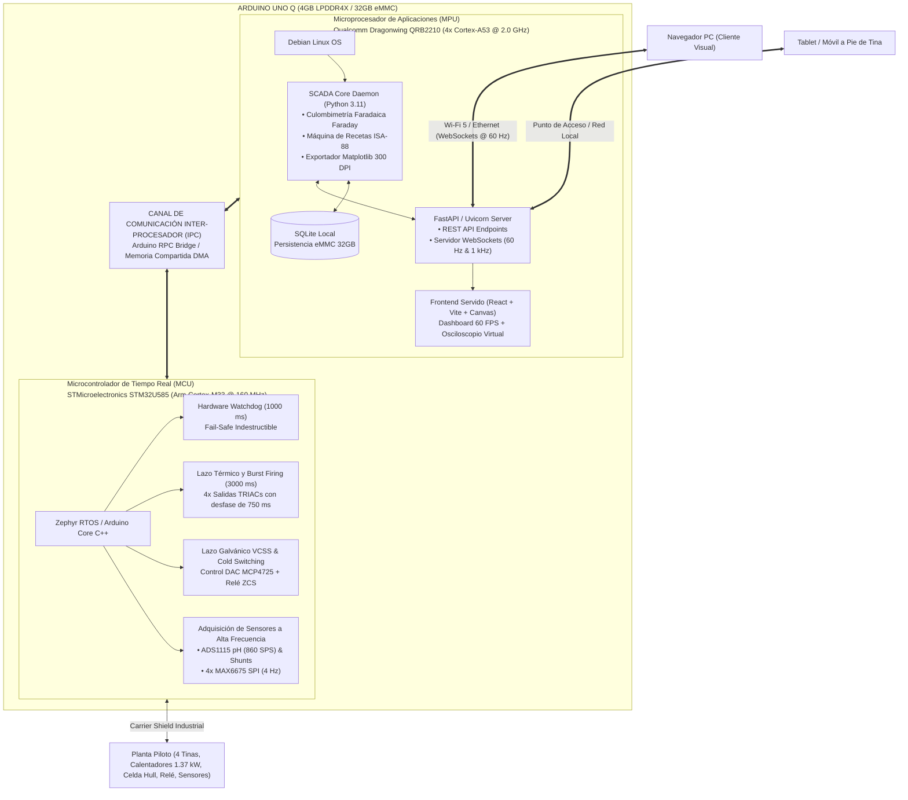
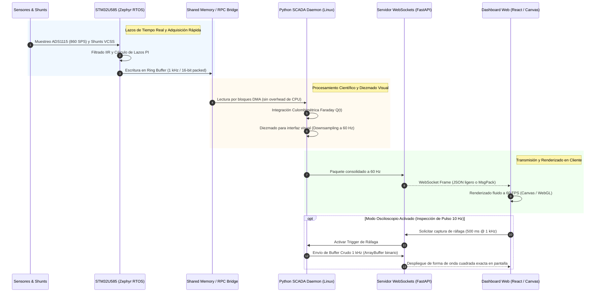

# Blueprint de Ingeniería: E.L.E.C.T.R.O.D.O-32 Edge (Arduino UNO Q 4GB RAM)
### Arquitectura Edge Computing, Telemetría Embebida de Alta Velocidad y Fusión Ciberfísica

**Autor / Equipo:** Equipo de Desarrollo de Planta Piloto de Electrodeposición y Galvanoplastia (Salvador² C Dev Team)  
**Fecha:** Octubre 2026  
**Estado:** Blueprint de Arquitectura y Especificación Técnica Formal (TRL 4 $\rightarrow$ TRL 6)  
**Proyecto Base:** [E.L.E.C.T.R.O.D.O-32 (ESP32-S3 RTOS 2.0 + ATmega328P)](../ELECTRODO_32/README.md)

---

## 1. Resumen Ejecutivo y Dictamen de Viabilidad

El presente documento evalúa y especifica la migración arquitectónica del sistema de control y supervisión de la Planta Piloto de Electrodeposición hacia una plataforma **Edge Computing Todo-en-Uno**, basada en el nuevo **Arduino UNO Q (variante con 4 GB de memoria LPDDR4X y 32 GB de almacenamiento eMMC)**.

En la arquitectura actual (versión RTOS 2.0), el sistema se encuentra distribuido en tres nodos físicos:
1. **Nodo Maestro:** Microcontrolador ESP32-S3 Dual-Core @ 240 MHz (FreeRTOS SMP, servidor web ligero HTTP polling @ 10 Hz y control electroquímico).
2. **Nodo Esclavo de Potencia:** Arduino Nano ATmega328P @ 16 MHz (control por ráfagas de tiempo proporcional de 4 TRIACs AC de 1.37 kW).
3. **Estación SCADA:** Computadora externa con Windows ejecutando el software `telemetria2.0` en Python (cálculo faradaico, gestión de recetas ISA-88, culombimetría y generación de figuras a 300 DPI).

### Dictamen Técnico: ¿Es una buena idea?
**Dictamen: ALTAMENTE RECOMENDADO Y TÉCNICAMENTE SUPERIOR**, siempre que se implemente respetando una **partición asimétrica estricta de responsabilidades (AMP - Asymmetric Multiprocessing)** y se utilice un **Carrier Shield de grado industrial** para acondicionamiento de señales y aislamiento de ruido electromagnético (EMI).

| Parámetro Comparativo | Arquitectura Actual (ESP32-S3 + Nano + PC SCADA) | Nueva Arquitectura Propuesta (Proyecto_Uno - Arduino UNO Q) | Impacto y Ganancia Técnica |
| :--- | :--- | :--- | :--- |
| **Topología del Sistema** | 3 nodos (ESP32 + Nano + PC Windows remota) | **1 solo nodo físico embebido autónomo (Uno Q)** | Elimina cables, dependencias de PC de laboratorio encendida y enlaces Wi-Fi frágiles. |
| **Frecuencia de Telemetría** | 10 Hz (HTTP Polling con latencia $\approx 80\text{--}150\text{ ms}$) | **60 Hz continuo (WebSockets) + Ráfagas a 1 kHz** | Fluidez visual a 60 FPS y osciloscopio real para pulsos de 10 Hz / 20% duty cycle. |
| **Procesamiento de Datos** | Distribuido (ESP32 empaqueta JSON / PC calcula) | **Linux Debian Nativo (Quad-Core A53 @ 2.0 GHz)** | Ejecución local del motor analítico en Python, SQLite y reportes científicos a 300 DPI. |
| **Seguridad de Potencia AC** | Nano esclavo físico con WDT hardware (1s) | **STM32U585 Cortex-M33 @ 160 MHz con WDT dedicado** | Concurrencia determinista de tiempo real sin depender del sistema operativo Linux. |
| **Interfaz de Usuario** | App Tkinter de escritorio en PC + Web básica ESP32 | **Web App moderna React/Vite/Canvas servida por Uno Q** | Acceso universal desde cualquier navegador (PC, tablet o smartphone) sin instalar nada. |
| **Costo Electrónico Base** | $\approx \$11.60\text{ USD}$ (ESP32-S3 + Nano) + Requiere PC | $\approx \$85.00\text{ USD}$ (Uno Q) + Carrier Shield $\approx \$18\text{ USD}$ | Mayor costo de tarjeta, pero ahorra una PC industrial dedicada y simplifica el cableado. |

---

## 2. Arquitectura de Hardware: Partición Asimétrica (AMP)

El Arduino UNO Q combina en una misma placa dos procesadores independientes conectados internamente mediante un bus de comunicación de alta velocidad (RPC Bridge / Shared Memory):



### 2.1 Rol del Microprocesador Qualcomm QRB2210 (Entorno Linux Debian)
1. **Adquisición Continua por Bridge RPC:** Lee paquetes estructurados del STM32 a través del Bridge interno sin sobrecargar el bus físico.
2. **Motor Electroquímico y Culombimetría Faradaica:** Integra la corriente en lazo cerrado ($Q = \int I \, dt$), calcula masas de electrodeposición teóricas (modelo aditivo bicapa $\text{Zn} + \text{Ni}$) y eficiencias catódicas en tiempo real.
3. **Persistencia Transaccional (SQLite):** Guarda en la memoria eMMC de 32 GB cada muestra, evento ISA-88, alarma y cambio de receta, permitiendo auditoría continua y recuperación ante caídas.
4. **Servidor Web y Streaming WebSockets:** Aloja FastAPI y sirve la aplicación web interactiva en React/Vite. Transmite los datos a 60 Hz para visualización general y ráfagas de 1 kHz para el osciloscopio de corriente pulsada.
5. **Generador Headless de Reportes Científicos:** Ejecuta scripts de `matplotlib` para generar gráficos vectoriales y PNG a 300 DPI, listos para descargar desde el navegador en formato de artículo o reporte técnico.

### 2.2 Rol del Microcontrolador STM32U585 (Coprocesador de Tiempo Real)
1. **Control de Potencia Térmica de 4 Canales (Sustituto del Nano):** Modulación por tiempo proporcional (Burst Firing) en ventanas de 3000 ms con desfase temporal de 750 ms entre canales (para evitar picos simultáneos de 1.37 kW).
2. **Watchdog de Hardware (1.0 s) e Interlocks Físicos:** Si el sistema operativo Linux se cuelga, el STM32 mantiene un watchdog independiente que, ante la pérdida de pulso de vida (*heartbeat*) del MPU en más de 2000 ms, apaga inmediatamente todas las compuertas de los TRIACs y anula la consigna del VCSS.
3. **Conmutación en Frío (Cold Switching / ZCS):** Orquesta el apagado previo de la consigna analógica del DAC MCP4725 ($I = 0.00\text{ A}$), el retardo de disipación de 30 ms y la apertura física del relé de aislamiento de 2 canales.
4. **Muestreo de ADS1115 y MAX6675:** Adquiere los termopares por bus SPI compartido y muestrea el electrodo de pH a 860 SPS con filtrado digital IIR en cascada.

---

## 3. Especificación del Carrier Shield Dedicado (Hardware Interface)

Dado que el Arduino UNO Q posee el factor de forma estándar de Arduino UNO con niveles lógicos estrictamente a **3.3V** en sus GPIOs, el diseño de un **Carrier Shield personalizado** es indispensable para garantizar robustez, protección electromagnética y adaptabilidad de niveles.

### 3.1 Asignación y Mapeo Exacto de Pines (Formato UNO)

| Pin Cabecera Uno | Nombre de Señal | Tipo de I/O | Nivel Lógico | Dispositivo / Conexión Externa | Función en la Planta |
| :---: | :--- | :---: | :---: | :--- | :--- |
| **D0** | `RX_DEBUG` | Entrada | 3.3V | Puerto Serie / Debugger | Reservado para depuración y consola serial |
| **D1** | `TX_DEBUG` | Salida | 3.3V | Puerto Serie / Debugger | Reservado para depuración y consola serial |
| **D2** | `ZC_INPUT` | Entrada | 3.3V (Opto) | Optoacoplador 4N35 / Cruce por Cero | Interrupción externa (EXTI) para sincronización AC (S11) |
| **D3** | `RELE_VCSS` | Salida | Buffer 5V | Módulo de 2 Relevadores (Bobina 5V) | Corte bipolar ZCS (+12V VDD y Retorno) Active-LOW |
| **D4** | `GATE_TC1` | Salida | Buffer 5V | MOC3021 / TRIAC BTA24-800BW | Tina 1: Desengrase Alcalino (Resistencia 450W AC) |
| **D5** | `GATE_TC2` | Salida | Buffer 5V | MOC3021 / TRIAC BTA24-800BW | Tina 2: Decapado Alcalino (Resistencia 450W AC) |
| **D6** | `GATE_TC3` | Salida | Buffer 5V | MOC3021 / TRIAC BTA24-800BW | Tina 3: Celda Hull 267 mL (Cartucho 18W AC) |
| **D7** | `GATE_TC4` | Salida | Buffer 5V | MOC3021 / TRIAC BTA24-800BW | Tina 4: Niquelado sobre Zinc (Resistencia 450W AC) |
| **D8** | `CS_TC0` | Salida | 3.3V | MAX6675 Tina 1 | Chip Select SPI Termopar Tina 1 |
| **D9** | `CS_TC1` | Salida | 3.3V | MAX6675 Tina 2 | Chip Select SPI Termopar Tina 2 |
| **D10** | `CS_TC2` | Salida | 3.3V | MAX6675 Tina 3 | Chip Select SPI Termopar Celda Hull |
| **D11** | `CS_TC3` | Salida | 3.3V | MAX6675 Tina 4 | Chip Select SPI Termopar Tina Niquelado |
| **D12** | `SPI_MISO` | Entrada | 3.3V | MAX6675 Bus Compartido (SO) | Datos de temperatura leídos desde los 4 módulos |
| **D13** | `SPI_SCK` | Salida | 3.3V | MAX6675 Bus Compartido (SCK) | Reloj SPI compartido a 4 MHz |
| **SDA** | `I2C_SDA` | Bidireccional | 3.3V | Bus I2C Fast-Mode (400 kHz) | ADS1115 (`0x48`), MCP4725 (`0x60`), AHT20 (`0x38`), BMP280 |
| **SCL** | `I2C_SCL` | Salida | 3.3V | Bus I2C Fast-Mode (400 kHz) | Reloj I2C Fast-Mode (400 kHz) |
| **A0-A5** | `ANALOG_AUX`| Analógico | 0–3.3V | Borneras de expansión | Disponibles para telemetría analógica directa ADC STM32 |

### 3.2 Circuito de Adaptación de Niveles para Compuertas TRIAC y Relé
Los optoacopladores MOC3021 requieren una corriente de disparo típica de $I_{\text{FT}} \approx 15\text{ mA}$. Un pin GPIO de 3.3V del STM32 no debe cargarse directamente con esta corriente.  
El Carrier Shield integrará un arreglo de búfer inversor/no inversor tipo **74HCT541** o transistores de señal **2N7002 / BC847** alimentados desde la línea limpia de **+5V**, garantizando una saturación óptima del LED infrarrojo del MOC3021 con resistencias limitadoras de $220\,\Omega$ ($I_F \approx 17.2\text{ mA}$) y un disparo certero sin sobrecargar el microcontrolador.

### 3.3 Aislamiento Galvánico y Protecciones TVS Integradas en el Shield
1. **Borneras de Tornillo Industriales:** Todas las conexiones hacia el exterior (sensores de temperatura, pH, relé y potencia) se realizarán mediante clemas fijas tipo Phoenix Contact.
2. **Supresores ESD (USBLC6-2SC6 / TVS Array):** Protecciones en las líneas externas de I2C, SPI y analógicas para prevenir descargas electrostáticas al manipular electrodos o reactivos.
3. **Plano de Masa Separado (Star Grounding):** Masa analógica (AGND) para el módulo ADS1115 y el sensor de pH, desacoplada de la masa digital (DGND) y de la masa de potencia (PGND) mediante una perla de ferrita (*ferrite bead*).

---

## 4. Estrategia de Telemetría Dual-Rate (60 Hz + 1 kHz)

Para cumplir con el objetivo de **telemetría embebida de mucha mayor velocidad** manteniendo el navegador web fluido y responsivo:



### Características de la Telemetría Dual-Rate:
1. **Flujo Visual Continuo (60 Hz):**  
   Envía cada 16.6 ms un paquete con las temperaturas de las 4 tinas, consignas térmicas, estado de compuertas TRIAC, pH actual, corriente promedio, voltaje y masa electrodepositada acumulada. Al estar alineado a 60 Hz, el navegador renderiza sin caídas de cuadros (*frame drops*) ni acumulación de eventos en la cola de JavaScript.
2. **Ráfagas de Alta Frecuencia (Osciloscopio a 1 kHz):**  
   En corriente pulsada (10 Hz, 20% duty cycle, periodo 100 ms con pulso activo de 20 ms), una telemetría tradicional a 10 Hz pierde completamente la forma de onda. Con el modo osciloscopio en el Uno Q, el STM32 almacena 1000 muestras por segundo durante la ventana de inspección y las transmite como un bloque binario (*typed array*), graficando con fidelidad absoluta los tiempos de subida, respuesta transitoria y estabilidad del sumidero analógico.

---

## 5. Software Stack Embebido en Linux (Qualcomm QRB2210)

El microprocesador ejecuta una distribución Debian Linux optimizada con servicios gestionados mediante `systemd`:

### 5.1 Estructura de Servicios Linux
1. **`planta-scada.service`:** Servicio principal en Python 3.11.
   - Lee el Bridge RPC con el STM32.
   - Ejecuta la máquina de estados ISA-88 (Desengrase $\rightarrow$ Decapado $\rightarrow$ Zincado $\rightarrow$ Niquelado).
   - Realiza la integración de Faraday: $\Delta m = \frac{M \cdot I \cdot \Delta t}{z \cdot F}$.
   - Escribe en SQLite local (`/var/lib/planta/experimentos.db`).
2. **`planta-web.service`:** Servidor FastAPI + Uvicorn sirviendo los endpoints REST y la conexión WebSockets en el puerto 80/443.
3. **`planta-report.service`:** Generador de reportes en segundo plano usando `matplotlib` con hoja de estilo científica y resolución de 300 DPI, almacenando los PDFs y gráficos en `/var/www/reportes/`.

---

## 6. Estructura de Directorios del Repositorio para `ELECTRODO_32_Uno`

Para salvaguardar la versión de producción actual (que cuenta con 62 pruebas unitarias pasando y se utiliza para el cartel SMEQ 2026), `ELECTRODO_32_Uno` se desarrolla de forma aislada e independiente en su propio directorio dedicado:

```text
C:\Proyecto\
├── ELECTRODO_32/                     <- (V1 Estable: ESP32-S3 + Nano2 + SCADA PC)
│   ├── firmware/                     <- Firmware RTOS 2.0 y JELDimmer2
│   ├── hardware/pcb/                 <- Placa Madre ESP32-S3 Rev 5.0
│   ├── eventos/                      <- Hub de eventos (Innovafest y SMEQ)
│   └── software/telemetria2.0/       <- SCADA Desktop PC
│
└── ELECTRODO_32_Uno/                 <- SUBSISTEMA EDGE INTEGRADO (ARDUINO UNO Q)
    ├── README.md                     <- Guía de arranque y arquitectura del Uno Q
    ├── PROYECTO_UNO_BLUEPRINT.md     <- Este documento maestro de arquitectura
    ├── hardware/pcb/carrier_shield_uno_q/ <- Carrier Shield Rev 5.1 (4 capas, KiCad, Gerbers)
    │   └── PINOUT_MAP.md             <- Distribución detallada de pines y borneras
    ├── firmware_stm32/               <- Código C++ de tiempo real (Zephyr / Arduino Core)
    │   ├── platformio.ini
    │   └── src/
    │       ├── main.cpp              <- Bucle de control, TRIACs y Bridge RPC
    │       └── hal_shield.h          <- Asignación de pines y periféricos
    └── edge_scada_linux/             <- Backend en Python y servidor WebSockets
        ├── app/
        │   ├── main.py               <- Entrada principal de la aplicación FastAPI
        │   ├── bridge_rpc.py         <- Enlace con el STM32U585
        │   ├── culombimetria.py      <- Modelos de Faraday Zn/Ni y recetas ISA-88
        │   └── websockets.py         <- Canales de telemetría a 60 Hz y 1 kHz
        └── requirements.txt          <- Dependencias (FastAPI, uvicorn, sqlite3, matplotlib)
```

---

## 7. Plan de Implementación y Fases de Validación

1. **Fase 1 — Aprobación y Arquitectura Base (Completada con este Blueprint):**  
   Definición técnica de la partición de procesadores, modelo de telemetría y mapa de pines.
2. **Fase 2 — Diseño del Carrier Shield PCB:**  
   Esquema y ruteo de la placa adaptadora en KiCad con búfers de disparo 74HCT541, borneras industriales y plano de masa en estrella.
3. **Fase 3 — Firmware Real-Time en STM32U585:**  
   Programación del control de ráfagas para 4 TRIACs, lectura SPI de termopares, ADS1115 y watchdog de seguridad. Pruebas en banco con osciloscopio y cargas resistivas.
4. **Fase 4 — Stack Linux y Servidor WebSockets:**  
   Implementación del daemon de adquisición en Python, endpoints WebSockets a 60 Hz y base de datos SQLite embebida en Debian.
5. **Fase 5 — Validación Cruzada:**  
   Ejecución de ensayos comparativos frente al dataset de referencia de la versión RTOS 2.0 para verificar que la culombimetría, el espesor de película y el control térmico sean indistinguibles o superiores en precisión.
