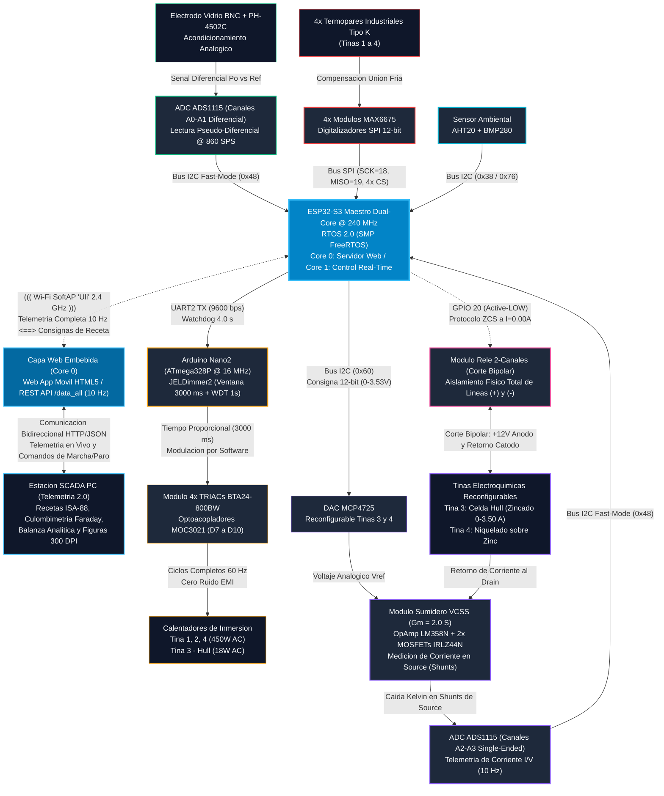
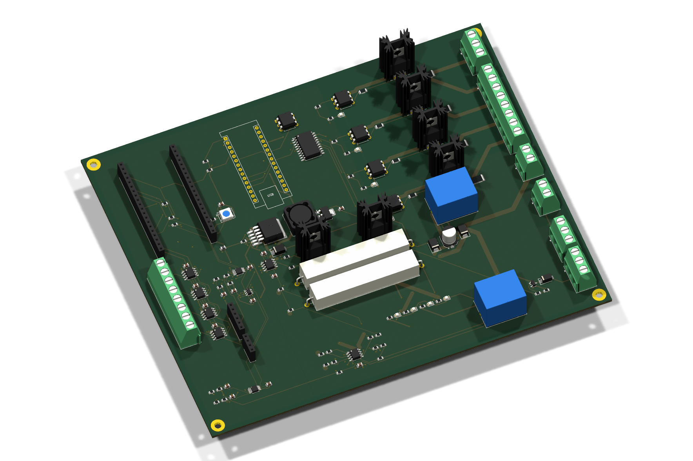

# E.L.E.C.T.R.O.D.O-32: Planta Piloto de Electrodeposición y Galvanoplastia
### Equipo de Laboratorio para Experimentación y Control en Tiempo Real con Obtención de Datos Operativos

[](https://github.com/Chavacastro98/Proyecto)
[](https://chavacastro98.github.io/Proyecto/)
[](https://chavacastro98.github.io/Proyecto/manual/)
[](tests/)
[](tests/)
[](hardware/pcb/placa_madre_esp32s3_uno/)
[](eventos/smeq_2026/)
[](eventos/innovafest/)
[](../ELECTRODO_32_Uno/README.md)

> [!NOTE]
> **E.L.E.C.T.R.O.D.O-32** es una plataforma ciberfísica de instrumentación y automatización electroquímica desarrollada en la Universidad de Guadalajara (CUCEI). Integra control térmico determinista en tiempo real, generador de corriente constante/pulsada en Celda Hull, supervisión SCADA con culombimetría faradaica y servidores web embebidos.
>
> 🗺️ **Mapa Integral de Arquitectura y Navegación:** [MAPA_DEL_PROYECTO.md](MAPA_DEL_PROYECTO.md)  
> 🌐 **Showcase Técnico Interactivo (GitHub Pages):** [https://chavacastro98.github.io/Proyecto/](https://chavacastro98.github.io/Proyecto/)  
> 🧪 **Manual de Operación Química & Laboratorio:** [documentos/manuales/MANUAL_DE_OPERACION_QUIMICA.html](documentos/manuales/MANUAL_DE_OPERACION_QUIMICA.html) | [En línea en Pages](https://chavacastro98.github.io/Proyecto/manual/)  
> 📑 **Congreso Nacional SMEQ 2026 (Folio CTS-C51):** [eventos/smeq_2026/](eventos/smeq_2026/)  
> 🏆 **InnovaFest 2026 (Expo Guadalajara):** [eventos/innovafest/](eventos/innovafest/)  

---

## 1. De qué trata este sistema

La galvanoplastia sobre aluminio es un proceso notoriamente delicado: el aluminio forma espontáneamente una película pasivante de óxido que arruina la adherencia, mientras que los electrolitos ácidos y las altas corrientes de deposición generan ruido electromagnético y caídas de tensión parásitas que desestabilizan cualquier sensor estándar.

**E.L.E.C.T.R.O.D.O-32** resuelve ese reto construyendo una **planta piloto automatizada de 3 tinas de tratamiento químico + Celda Hull (267 mL)**, gobernada por una arquitectura distribuida donde el hardware, el circuito impreso maestro, el firmware en tiempo real y el software de supervisión en PC trabajan como una sola unidad:

1. **Etapa 1 — Desengrase Alcalino (85-90 °C, 240 s):** Limpieza termoquímica superficial con $\text{Na}_3\text{PO}_4$, $\text{Na}_2\text{SiO}_3$ y PEG-400.
2. **Etapa 2 — Decapado y Activación Alcalina (85-90 °C, 120 s):** Remoción selectiva de la película pasivante de alúmina sin atacar el metal base.
3. **Etapa 3 — Zincado en Celda Hull (25 °C o 40 °C, 120 o 300 s):** Electrodeposición en celda trapezoidal normalizada de 267 mL con corriente continua (1.50 A DC) o pulsada (10 Hz / 20% duty cycle) para evaluar el gradiente de densidad de corriente sobre toda la longitud de la probeta.
4. **Etapa 4 — Niquelado Electrolítico sobre Zinc (30-40 °C, 600 s):** Depósito protector final a 1.13 A DC con baño estabilizado para inhibir el desplazamiento galvánico espontáneo sobre el zinc subyacente.

---

## 2. Arquitectura Técnica (Versión RTOS 2.0)

El sistema opera con la versión de producción **RTOS 2.0**, diseñada para garantizar determinismo temporal, aislamiento total de ruido e instrumentación electroquímica de alta fidelidad:



---

## 3. Sección de Hardware y PCBs: Placa Madre Rev 5.0

La electrónica de control físico ha madurado a un diseño industrial estandarizado en KiCad, disponible en [`hardware/pcb/placa_madre_esp32s3_uno/`](hardware/pcb/placa_madre_esp32s3_uno/):

<p align="center">
  
</p>

<p align="center">
  <em>Figura 3.1: Render 3D fotorrealista (Vista Isométrica) de la Placa Madre Industrial Rev 5.0 para ESP32-S3 y Arduino Nano.</em>
</p>

* **Dimensiones y Capas:** $100\text{ mm} \times 100\text{ mm}$, 2 capas en FR-4 TG155, cobre de 1 oz ($35\ \mu\text{m}$) con pistas de potencia ensanchadas (>2.5 mm) y acabado ENIG / HASL con plomo.
* **Aislamiento de Ruido:** Separación física de planos de masa analógica (AGND) e instrumentación digital (DGND), desacoplamiento óptico para los 4 TRIACs (MOC3021 + 4N35) y conmutación en cruce por cero (ZCS a 60 Hz).
* **Entregables de Fabricación:**
  * [Esquemático Electrónico en PDF](hardware/pcb/placa_madre_esp32s3_uno/placa_madre_esp32s3_uno_sch.pdf)
  * [Paquete de Gerbers para JLCPCB (ZIP)](hardware/pcb/placa_madre_esp32s3_uno/GERBERS_PLACA_MADRE_ESP32S3_UNO_REV5.zip)
  * [Lista de Materiales BOM](hardware/pcb/placa_madre_esp32s3_uno/BOM_JLCPCB_ESP32S3_UNO_REV5.csv) y [Coordenadas Pick & Place CPL](hardware/pcb/placa_madre_esp32s3_uno/CPL_JLCPCB_ESP32S3_UNO_REV5.csv)
  * [Modelo 3D CAD STEP](hardware/pcb/placa_madre_esp32s3_uno/placa_madre_esp32s3_uno_3d.step)
  * Renders 3D en Ultra-Alta Definición: [Vista Isométrica](hardware/pcb/placa_madre_esp32s3_uno/render_3d_placa_madre_esp32s3_uno_iso.png) | [Vista Superior](hardware/pcb/placa_madre_esp32s3_uno/render_3d_placa_madre_esp32s3_uno_top.png)

> [!TIP]
> Para la variante de alta velocidad basada en **Arduino UNO Q (Edge Computing)**, consulta el [Carrier Shield Industrial Rev 5.1](../ELECTRODO_32_Uno/hardware/pcb/carrier_shield_uno_q/README.md).

---

## 4. Exposiciones, Congresos y Eventos Tecnológicos

El proyecto cuenta con un espacio dedicado a la divulgación, transferencia tecnológica y memoria científica en [`eventos/`](eventos/):

* **[InnovaFest Guadalajara 2026 (`eventos/innovafest/`)](eventos/innovafest/):**
  * Presentación oficial en **Expo Guadalajara** (23 de Octubre de 2026) en la categoría **Industria 4.0 y Automatización**.
  * Expediente de postulación, [Ficha Técnica Oficial](eventos/innovafest/documentos/FICHA_TECNICA_INNOVAFEST_2026.pdf), video pitch ejecutivo y galería de más de 670 registros fotográficos clasificados del prototipo in-operando.
* **[41º Congreso Nacional SMEQ 2026 (`eventos/smeq_2026/`)](eventos/smeq_2026/):**
  * Ponencia formal de investigación: **Folio CTS-C51** (*Optimización de Recubrimientos de Zinc sobre Aluminio 6061 T-6*).
  * [Cartel Científico Oficial en PDF](eventos/smeq_2026/cartel_cientifico/Cartel%20PModular%20044.pptx.pdf) y [Hoja de Mesa con Código QR en PDF](eventos/smeq_2026/cartel_cientifico/HOJA_QR_MESA_SMEQ2026.pdf).
  * [Memoria en Extenso](eventos/smeq_2026/documentos_oficiales/) y reporte final de cinéticas electroquímicas.

---

## 5. Estructura del Repositorio

```
ELECTRODO_32/
├── MAPA_DEL_PROYECTO.md       <- Índice maestro y matriz de navegación técnica
├── Iniciar_Sistema.bat        <- Panel de control unificado por consola
├── Iniciar_Telemetria_2.0.bat <- Lanzador directo del SCADA Telemetría 2.0
├── launcher.py                <- Interfaz gráfica lanzadora en Python
├── MATRIZ_INTERLOCKS.md       <- Enclavamientos y seguridad ISA-84 / SIL-2
│
├── hardware/                  <- Electrónica e ingeniería física
│   ├── pcb/                   <- Circuitos impresos de producción (KiCad, Gerbers, BOM, 3D)
│   │   └── placa_madre_esp32s3_uno/
│   ├── esquemas_electricos/   <- Diagramas de cableado y alambrado de potencia
│   └── control_matlab/        <- Modelos de transferencia de calor y control PI
│
├── eventos/                   <- Hub de exposiciones y congresos
│   ├── innovafest/            <- Postulación, pitch, ficha oficial y galería
│   └── smeq_2026/             <- Cartel Folio CTS-C51, memorias y hoja QR
│
├── software/                  <- Software de estación y supervisión
│   ├── telemetria2.0/         <- SCADA de producción (Tkinter, Faraday, Recetas ISA-88)
│   └── exportar_graficas_offline.py <- Generador de figuras científicas a 300 DPI
│
├── firmware/                  <- Código embebido de tiempo real
│   ├── esp32s3/               <- Firmware ESP32-S3 RTOS 2.0 (FreeRTOS SMP)
│   └── nano2/                 <- Firmware esclavo ATmega328P (JELDimmer2)
│
├── documentos/                <- Manuales y literatura técnica
│   ├── manuales/              <- Manual de Operación Química y Protocolos
│   ├── guias/                 <- Guías de desarrollo y CHANGELOG
│   └── academicos/            <- Protocolos de titulación y referencias
│
├── docs/                      <- Web pública para GitHub Pages (Showcase Web)
└── tests/                     <- Suite automatizada de pruebas (62 passed)
```

---

## 6. Aseguramiento de Calidad y Pruebas Automatizadas

El proyecto cuenta con una suite de **62 pruebas unitarias y de integración** que se ejecutan con `pytest` alcanzando un **95% de cobertura de código**:

```bash
python -m pytest -v
```

* **Física y Metrología ([tests/test_calculos.py](tests/test_calculos.py)):** Verificación matemática de la masa teórica faradaica en DC y pulsado ponderado por ciclo de trabajo, inmunidad de integración en reposo, modelo bicapa aditivo Zn+Ni, espesores micrométricos y linealización de retardo TRIAC de 60 Hz.
* **Interlocks de Seguridad ([tests/test_interlocks.py](tests/test_interlocks.py)):** Verificación del aislamiento entre electrodo de pH y lazo de corriente, enclavamiento por Fail-Safe, restricciones de calibración y conmutación ZCS.
* **Contratos de Telemetría ([tests/test_telemetria_json.py](tests/test_telemetria_json.py)):** Validación de rangos del DAC (0 a 4095), transconductancia Gm, resolución de sensores y manejo defensivo ante pérdidas parciales de paquetes.
* **Consistencia Web ([tests/test_constantes_web.py](tests/test_constantes_web.py)):** Asegura que las constantes de ingeniería del SCADA coincidan con la web pública en `docs/index.html`.

---

## 7. Puesta en Marcha

### Requisitos:
* Sistema operativo Windows 10 u 11.
* Python 3.9 o superior.

### Ejecución:
1. Instalar dependencias:
   ```bash
   pip install -r requirements.txt
   ```
2. Iniciar el Panel Maestro:
   * Doble clic en [`Iniciar_Sistema.bat`](Iniciar_Sistema.bat), o
   * Ejecutar: `python launcher.py`
3. Iniciar directamente el SCADA de Telemetría 2.0:
   * Doble clic en [`Iniciar_Telemetria_2.0.bat`](Iniciar_Telemetria_2.0.bat)

---

## 8. Equipo de Investigación y Desarrollo

### 🧪 Investigación Electroquímica & Tesis de Grado
* **Víctor Ulises Gutiérrez Ramírez** — [victor.gutierrez7221@alumnos.udg.mx](mailto:victor.gutierrez7221@alumnos.udg.mx)  
  * *Investigación electroquímica, formulación de baños, diseño experimental Celda Hull y gravimetría.*

### ⚙️ Automatización, Hardware e Instrumentación (Salvador² C Dev Team)
* **Salvador Castro Pérez** — [salvador.castro7435@alumnos.udg.mx](mailto:salvador.castro7435@alumnos.udg.mx)  
* **Fernando Salvador Samayoa Martínez** — [fernando.samayoa0621@alumnos.udg.mx](mailto:fernando.samayoa0621@alumnos.udg.mx)  

### 🎓 Directores de Tesis
* **Dr. Omar Alejandro González Meza** — Profesor Investigador, CUCEI, Universidad de Guadalajara.
* **Dr. Norberto Casillas Santana** — Profesor Investigador, Departamento de Química, CUCEI, Universidad de Guadalajara.

---

**Salvador² C Dev Team**  
*Centro Universitario de Ciencias Exactas e Ingenierías (CUCEI) — Universidad de Guadalajara.*
